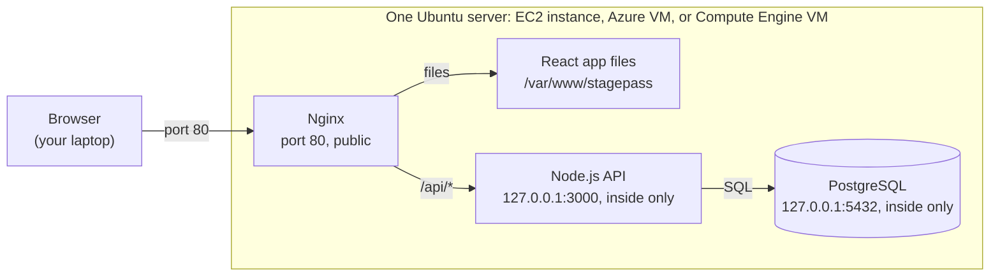

# Deploy a full-stack app to one server

## What we're going to do

You'll host a real full-stack application on the cloud provider you signed up for: AWS, Azure, or Google Cloud. The frontend, the backend, and the database all run on **one server**.

The app is **Stagepass**, a ticketing app for live events, like a small Ticketmaster or Eventbrite:

- Organizers create events with a seat map and prices
- Customers pick seats, and the seats are held for them for 10 minutes
- If they pay in time, the seats are theirs. If not, the hold expires and the seats go back on sale

You don't need to write any code for this step. The goal is to see every part of a web application running on a real server, and to be able to point at each one.

By the end you will have:

1. A server running in the cloud
2. The app installed on it and open in your browser at your server's IP address
3. Seen each part (web server, API, database) running as its own process
4. Watched the database stop two people from buying the same seat

## What runs on the server

Your server will run three separate programs:

- **Nginx**, the web server. The only program the internet can reach, on port 80.
- **The Node.js API**, the backend. Handles login, events, and bookings.
- **PostgreSQL**, the database. Stores users, events, seats, and bookings.



The browser only ever talks to Nginx. Nginx sends back the React files itself and passes `/api` requests to the API, and only the API talks to the database.

## What Nginx is, and why we use it

Nginx (pronounced "engine-x") is a web server. It's a program that listens on a port, usually 80 for HTTP and 443 for HTTPS, receives requests from browsers, and decides what to send back. A large share of the websites on the internet run Nginx in front of their application.

In our setup it does two jobs:

1. **Serves the frontend files.** When you build a React app, you get plain HTML, JavaScript, and CSS files. They don't need Node.js to run, they just need to be sent to the browser. Nginx reads them from disk and sends them, which is exactly what it's built for.
2. **Forwards API requests to the backend.** Every request that starts with `/api` is passed to the Node.js API running on the same server. This is called a **reverse proxy**: the browser talks to Nginx, and Nginx talks to the API on the browser's behalf.

For example:

- The browser asks for `http://<your-ip>/events/3`. Nginx sends back the React app's `index.html`.
- The React app then asks for `http://<your-ip>/api/events/3`. Nginx forwards that to the API at `127.0.0.1:3000` and returns the API's answer.

Why not let the browser talk to Node.js directly?

- **Only one port is open to the internet.** The API and the database listen only inside the server, so nobody outside can reach them directly. Nginx is the single entry point.
- **Frontend and API share one address.** The browser sees one site, so there's no CORS setup and the login cookie works without extra configuration.
- **Each program does what it's good at.** Nginx handles connections and static files. Node.js only runs your business logic.
- **It's how real setups look.** HTTPS certificates and load balancing are configured at this same layer. The load balancer you'll add in [SCALE.md](SCALE.md) works on the same idea: one entry point that forwards requests to the servers behind it.

## Same thing, different names

All three clouds rent you the same thing: a Linux machine in their data center. Only the names in the console change.

| What it is | AWS | Azure | Google Cloud |
| --- | --- | --- | --- |
| Virtual server | EC2 instance | Virtual Machine | Compute Engine VM instance |
| Firewall that opens ports | Security group | Network security group (NSG) | VPC firewall rule |
| Key you log in with | Key pair (`.pem` file) | SSH key pair (`.pem` file) | Browser SSH button, no file needed |
| Server's internet address | Public IPv4 address | Public IP address | External IP |
| Login user on Ubuntu | `ubuntu` | `azureuser` (you pick it) | Your Google username |
| Free-tier size to pick | `t3.micro` | `B1s` or `B2ats_v2` | `e2-micro` |

All three free-tier sizes have about 1 GB of RAM, which is enough for this app.

---

## Step 1. Create the server

Follow the part for your cloud, then go to Step 2. Whichever cloud you use, you need the same four things: **Ubuntu 24.04**, the **free-tier size**, a **way to log in**, and ports **22** (SSH, for you) and **80** (HTTP, for the browser) open.

### AWS: EC2

1. Open the **EC2** console and pick a region near you (top right).
2. Click **Launch instance**.
3. **Name:** `stagepass`
4. **Application and OS Images:** Ubuntu, then **Ubuntu Server 24.04 LTS**.
5. **Instance type:** `t3.micro` (marked "Free tier eligible").
6. **Key pair:** click **Create new key pair**, name it `stagepass`, type RSA, format `.pem`. The file downloads once. Keep it, you can't download it again.
7. **Network settings:** check **Allow SSH traffic** and **Allow HTTP traffic from the internet**. Leave SSH set to **Anywhere**. This creates one security group and attaches it to the instance. That attached group is the only firewall that counts. A second group, even one named `stagepass`, does nothing until you attach it on the instance's **Security** tab.
8. Leave storage as it is and click **Launch instance**.
9. Open the instance and copy its **Public IPv4 address**. On the **Security** tab, click the listed group (usually `launch-wizard-1`) and confirm its inbound rules include SSH (TCP 22) and HTTP (TCP 80).

### Azure: Virtual Machines

1. In the Azure portal, search for **Virtual machines**, click **Create**, then **Azure virtual machine**.
2. **Resource group:** click **Create new** and name it `stagepass-rg`. Everything for this server goes in it, so deleting it later is one click.
3. **Virtual machine name:** `stagepass`. **Region:** one near you.
4. **Image:** **Ubuntu Server 24.04 LTS, x64 Gen2**.
5. **Size:** click **See all sizes** and pick `B1s` or `B2ats_v2` (marked "Free services eligible").
6. **Authentication type:** SSH public key. **Username:** `azureuser`. **SSH public key source:** Generate new key pair.
7. **Public inbound ports:** Allow selected ports, then select **HTTP (80)** and **SSH (22)**. This creates the network security group.
8. Click **Review + create**, then **Create**, then **Download private key and create resource**. Keep the `.pem` file.
9. When it's done, click **Go to resource** and copy the **Public IP address**.

### Google Cloud: Compute Engine

1. In the console, go to **Compute Engine**, then **VM instances**. Enable the Compute Engine API if it asks.
2. Click **Create instance**. **Name:** `stagepass`
3. **Region:** `us-central1`, `us-east1`, or `us-west1`. Only these three regions have the always-free `e2-micro`.
4. **Machine type:** series **E2**, then `e2-micro`.
5. **OS and storage:** click **Change**. Operating system **Ubuntu**, version **Ubuntu 24.04 LTS** (x86/64), boot disk type **Standard persistent disk**, size **30 GB**. The default disk type isn't covered by the free tier.
6. **Networking:** under Firewall, check **Allow HTTP traffic**. SSH is allowed by default.
7. Click **Create** and copy the **External IP** from the VM list.

## Step 2. Connect to the server

**AWS and Azure:** open a terminal on your computer (Terminal on Mac and Linux, PowerShell on Windows) and run:

```bash
# Mac and Linux only: SSH refuses a key file other users can read
chmod 400 ~/Downloads/stagepass.pem

# AWS
ssh -i ~/Downloads/stagepass.pem ubuntu@<public-ip>

# Azure
ssh -i ~/Downloads/stagepass.pem azureuser@<public-ip>
```

Use the path where your `.pem` file actually is, and type `yes` when it asks about the fingerprint.

**Google Cloud:** click the **SSH** button next to your VM in the VM instances list. A terminal opens in your browser.

You're in when you see a prompt like `ubuntu@ip-172-31-5-20:~$`. Every command from here on runs on the server, not on your computer.

## Step 3. Install the app

On the server, run these two commands:

```bash
sudo git clone https://github.com/DeveloperMastery/stagepass.git /opt/stagepass
sudo /opt/stagepass/deploy/setup.sh
```

The first one downloads the code. The second one installs and starts everything. It takes about 3 to 5 minutes on a free-tier server and ends with:

```
API is up: {"status":"ok","server":"..."}

Done. Open http://<your-server-public-ip> in your browser.
```

The script is about 150 lines and you can read it in [`deploy/setup.sh`](deploy/setup.sh). Here's what it does, in order:

1. **Adds 2 GB of swap.** Swap is disk space Linux uses as extra memory. 1 GB of RAM isn't enough to install the npm packages and build the React app, and without swap Linux kills the build.
2. **Installs Nginx, PostgreSQL, and Node.js 22.**
3. **Creates the database** with a random password and writes the API's settings to `/etc/stagepass/api.env`.
4. **Builds the API**, creates the tables, and adds demo events and two demo accounts.
5. **Builds the React app** and copies the files to `/var/www/stagepass`, where Nginx serves them from.
6. **Starts the API as a systemd service.** systemd is the part of Linux that starts programs on boot and restarts them if they crash.
7. **Configures Nginx** to serve the React files and forward `/api` to the API.

## Step 4. Check that it works

On the server:

```bash
# All three should say "active (running)"
systemctl status nginx stagepass-api postgresql --no-pager | grep -E "●|Active"

# The API answers through Nginx and can reach the database
curl http://localhost/api/health
```

Then open `http://<public-ip>` in your browser. Type the `http://` part yourself, because there's no HTTPS on this server yet. Then:

1. Log in as `customer@stagepass.dev` with password `customer123`
2. Open an event, pick two seats, and click **Reserve seats**
3. On the checkout page, click **Pay**
4. Your tickets show up under **My tickets**
5. Log out, log in as `organizer@stagepass.dev` with password `organizer123`, and open **Organizer**. The seats you bought show as sold, with the revenue

If all five work, your browser just talked to Nginx, Nginx talked to the API, and the API read and wrote to the database, all on your one server.

## Step 5. Look around the server

Every part of the app is a normal Linux process. Look at each one:

```bash
# Which programs listen on which ports
sudo ss -ltnp
```

You'll see three lines that matter:

- `0.0.0.0:80` for **nginx**: open on every network address, so the internet can reach it
- `127.0.0.1:3000` for **node**: the API, reachable only from inside the server
- `127.0.0.1:5432` for **postgres**: the database, reachable only from inside the server

That's the single-server setup in one command: three processes, one machine, one public port.

Watch requests flow through the API while you click around the site:

```bash
sudo journalctl -u stagepass-api -f
```

Press `Ctrl+C` to stop. Then open the database and look at the data you just created:

```bash
sudo -u postgres psql stagepass
```

```sql
\dt                                          -- list the tables
SELECT status, COUNT(*) FROM seats GROUP BY status;
SELECT id, status, total_cents FROM bookings ORDER BY id DESC LIMIT 5;
\q
```

### Sell one seat twice

The hardest problem in a ticketing system: two people click the same seat at the same moment. Both requests read the seat, both see "available", and both save it as theirs.

The API prevents this with a database transaction and a row lock. Run the test that sends 50 requests for the same seat at once:

```bash
cd /opt/stagepass/api
npm run race-test
```

You should see exactly 1 request succeed and 49 get rejected. The [README](README.md#experiment-sell-one-seat-twice) shows how to turn the lock off and watch the same seat go to several people. Try it, then turn the lock back on.

---

## If something doesn't work

| What you see | What to do |
| --- | --- |
| The browser spins and times out | Port 80 isn't open. AWS: add an HTTP rule to the security group listed on the instance's **Security** tab. Azure: add an inbound rule for port 80 to the network security group. Google Cloud: edit the VM and check **Allow HTTP traffic**. |
| The browser says the public IP "refused to connect" | Expected before Step 3. The server is reachable, and nothing is serving the site yet. |
| `ssh: connect to host ... timed out` | SSH never reached the server, so the key is not the problem. Open the instance's **Security** tab and click the group listed there. Its inbound rules must include SSH, TCP 22. A rule on any other group does not apply. Also use the **Public IPv4** address in the `ssh` command. |
| `Permission denied (publickey)` | Wrong user or wrong key. AWS uses `ubuntu`, Azure uses the username you set. Check the path after `-i`. |
| `502 Bad Gateway` | Nginx is running but the API isn't. Run `sudo journalctl -u stagepass-api -n 50` to see why. |
| `npm` prints `Killed` during setup | The server ran out of memory. Check swap is on with `free -h`, then run `setup.sh` again. |

## When you're done

Next up is [SCALE.md](SCALE.md): a second server and a load balancer. If you're going straight on, keep this server, because you'll build on it.

Otherwise, delete it. A running server uses your free credits even when nobody visits it.

- **AWS:** EC2, select the instance, **Instance state**, then **Terminate instance**
- **Azure:** open the `stagepass-rg` resource group and click **Delete resource group**. This removes the VM, its disk, its IP, and its firewall together
- **Google Cloud:** VM instances, select the VM, then **Delete**

You can bring it all back any time by repeating Steps 1 to 3. That takes about 10 minutes.
